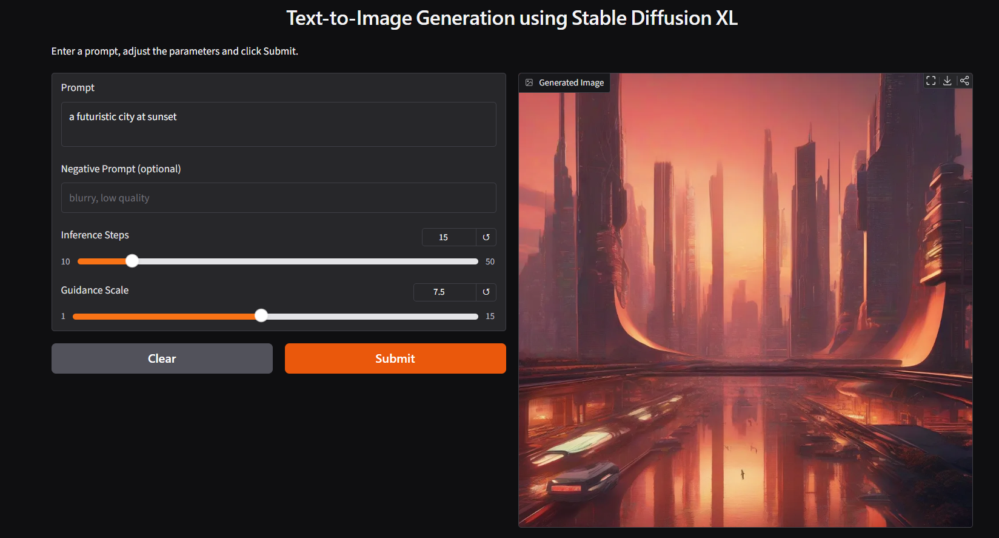

# Text-to-Image Generation using Stable Diffusion XL

Generate images from natural-language prompts using a pre-trained **Stable Diffusion XL** diffusion model through Hugging Face Diffusers, with an interactive **Gradio** interface (in Google Colab) and an optional **Flask + HTML/CSS/JS** web app.

*GenAI Lab, Experiment 4 — Department of Computer Science & Engineering (AIML), D Y Patil College of Engineering & Technology, Kolhapur.*

[](https://colab.research.google.com/github/srushtighatge25-commits/text-to-image-sdxl/blob/main/Exp4_Text_to_Image_SDXL.ipynb)

## Demo



*Gradio interface in Colab. Prompt: "a futuristic city at sunset", 15 inference steps, guidance scale 7.5.*

## Features

- Loads the pre-trained `stabilityai/stable-diffusion-xl-base-1.0` model with `DiffusionPipeline` in float16 on GPU
- Prompt, optional negative prompt, inference steps and guidance scale controls
- Gradio interface that runs directly in Colab
- Flask web app with a custom HTML/CSS/JS front end and image download
- Parameter comparison cells (steps 10/30/50, guidance 3/7.5/12)

## How it works

Diffusion models start from random noise and remove it step by step, guided by the text prompt, until an image forms. Inference steps control how many denoising iterations run; guidance scale controls how strongly the image follows the prompt.

## Project structure

```
text-to-image-sdxl/
├── Exp4_Text_to_Image_SDXL.ipynb   # Colab notebook (model + Gradio UI)
├── flask_app/
│   ├── app.py                      # Flask backend
│   ├── templates/index.html
│   └── static/
│       ├── style.css
│       └── script.js
├── assets/gradio-interface.png
├── requirements.txt
├── LICENSE
└── README.md
```

## Option 1: Run in Google Colab (recommended)

1. Click the **Open in Colab** badge above.
2. Select **Runtime → Change runtime type → T4 GPU**.
3. Run all cells. The first run downloads about 7 GB of model files.
4. The Gradio cell prints a public link; open it and generate images.

## Option 2: Run the Flask app locally

Requires an NVIDIA GPU with about 8 GB or more VRAM.

```bash
git clone https://github.com/srushtighatge25-commits/text-to-image-sdxl.git
cd text-to-image-sdxl
pip install -r requirements.txt
```

Save the model from Colab (last cells of the notebook), unzip it as `local_model/sdxl_base/`, then:

```bash
cd flask_app
# optional: point to the model folder
# export MODEL_PATH=../local_model/sdxl_base
python app.py
```

Open http://localhost:5000.

## Tips for better prompts

Describe the subject, environment, style, lighting and composition, for example:
`A futuristic city at sunset, cinematic lighting, highly detailed`.
Use the negative prompt for things to avoid, such as `blurry, low quality`.

## Tech stack

Python, PyTorch, Hugging Face Diffusers, Transformers, Accelerate, Safetensors, Gradio, Flask, HTML, CSS, JavaScript

## Acknowledgements

- [Stable Diffusion XL](https://huggingface.co/stabilityai/stable-diffusion-xl-base-1.0) by Stability AI
- Lab manual by Dr. Sachin Balawant Takmare

## License

MIT. Note that the SDXL model weights are covered by their own license on Hugging Face.
